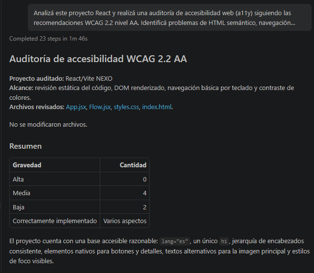
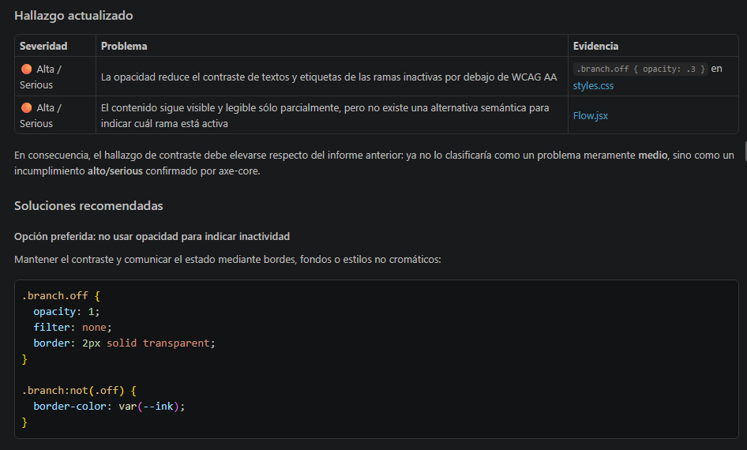
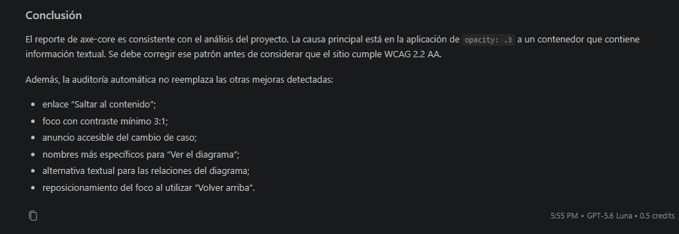
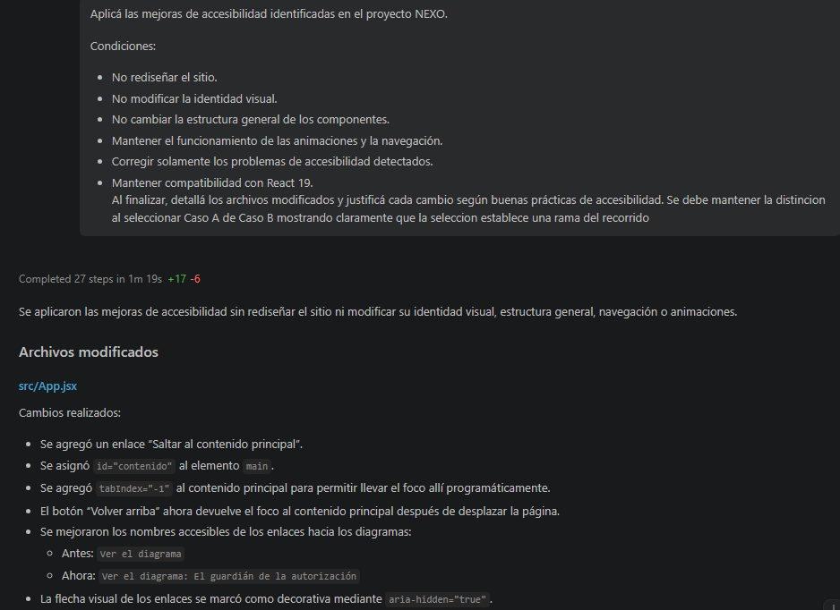
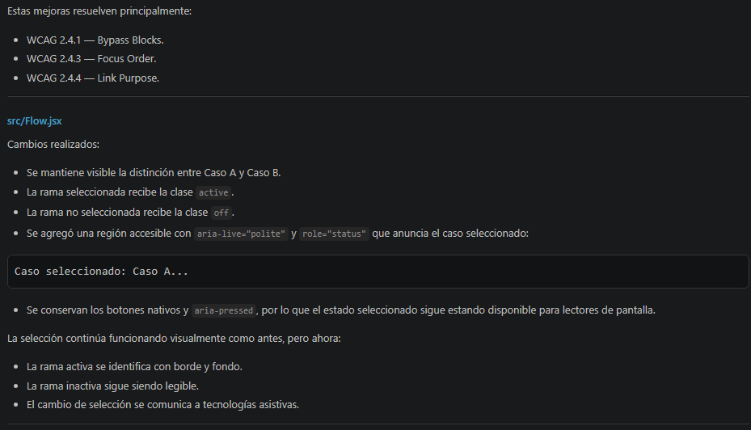
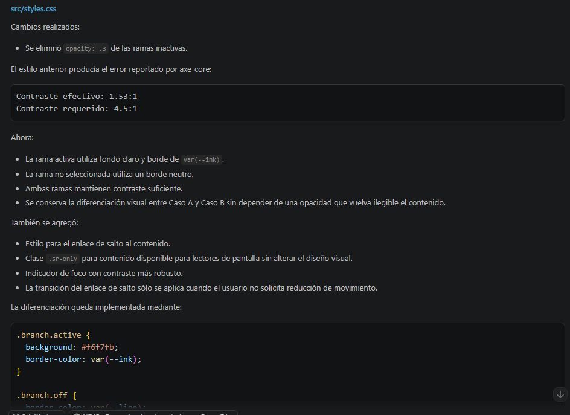
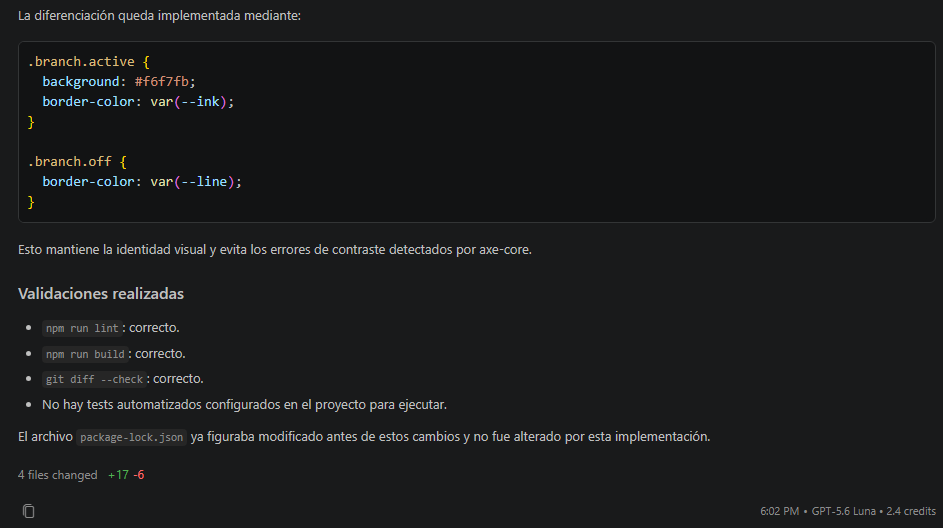
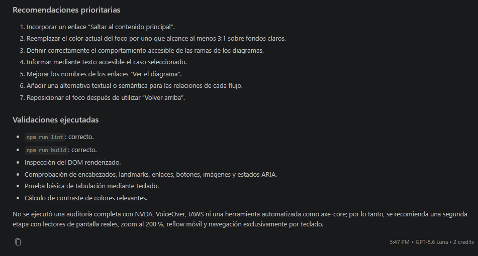

# TP3 · Dos sentencias. Dos soluciones. — Grupo 7 (IFTS 29)

- **Landing publicada:** <https://tp-3-front-ifts-29-grupo-7.vercel.app/>
- **Repositorio:** <https://github.com/SabatoCom24212/TP3-FRONT-IFTS29-GRUPO-7>

## Asignación

- **Startup:** NEXO · Servicios y reparaciones (sorteo S11-B), creada en el IFTS 16.
- **Bloque:** Permisos y contratación
  - **R3:** «Si el cliente todavía no autorizó una propuesta concreta, el sistema la mantiene pendiente y no envía una solicitud de contratación.»
  - **R4:** «Si el cliente autoriza una propuesta vigente de un profesional verificado y disponible, el sistema envía la solicitud y la muestra pendiente de aceptación del profesional.»

## Integrantes y aportes

| Integrante | Aporte concreto |
| --- | --- |
| Ángel Sabato | Inició el proyecto, creó la primera versión y corrigió el renderizado, la navegación y el diseño responsive. |
| Flavio Rinaldi | Incorporó favicon SVG personalizado, optimizó metadatos/SEO en HTML e implementó botón interactivo «Volver arriba» para mejor UX. |

## Herramientas de IA

| Aplicación | Modelo | Uso | Cambios solicitados |
| --- | --- | --- | --- |
| Copilot en Visual Studio Code (plan gratuito) | GPT-6 Luna | Asistencia para crear, depurar y mejorar el sitio. | Layout según la consigna; corrección de renderizado y navegación; diseño responsive; formato del README. |
| Gemini / AI Assistant | Gemini 2.5 Flash / Pro | Asistencia para optimización SEO, UX y favicon. | Favicon vectorial de NEXO, metadatos en HTML y botón flotante de Scroll to Top en React. |

### Evidencia de iteración — Ángel Sabato

Las capturas que siguen corresponden a la iteración realizada por Ángel Sabato.

Primera versión del sitio → se detectaron errores de renderizado, enlaces del Header que no navegaban y problemas de adaptación a pantallas chicas → se solicitaron correcciones de navegación y responsive → se corrigió el renderizado, se repararon los enlaces con HashRouter, se adaptó el layout a distintos anchos de pantalla y se ajustó el formato de las tablas del README.


### Evidencia de iteración — Flavio Rinaldi

Segunda versión del sitio → falta de metadatos SEO, favicon genérico y necesidad de mejorar la navegación en pantallas extensas → se solicitó la incorporación de favicon personalizado SVG con la identidad visual de NEXO, etiquetas meta para accesibilidad e implementación de un componente interactivo de Scroll to Top → se agregó el favicon vectorial N, la descripción en el HTML y el botón flotante de retorno fluido en React.


### Evidencia de iteración — Marcelo Zárate

**Tercera versión del sitio:** incorporación de mejoras de accesibilidad web (a11y) en NEXO a partir de una auditoría asistida por Inteligencia Artificial y de la validación con axe.

**Cambios realizados:**

- Se revisó la estructura semántica y se incorporó un enlace para saltar directamente al contenido principal.
- Se mejoró la navegación mediante teclado con indicadores de foco visibles y la gestión del foco al volver al inicio.
- Se verificaron el contraste y la legibilidad de los textos y de los controles interactivos.
- Se agregó texto alternativo descriptivo al logo y se ocultaron de los lectores de pantalla los elementos decorativos.
- Los botones de selección de casos informan su estado con `aria-pressed` y anuncian el cambio mediante una región de estado.
- Se respetan las preferencias del sistema para reducir el movimiento, evitando animaciones y desplazamientos suaves cuando corresponde.
- Se documentó el proceso de auditoría y se incorporaron las evidencias del análisis asistido por IA y las validaciones con axe.

**Criterio de implementación:** las modificaciones mejoran la accesibilidad sin alterar el diseño, la identidad visual ni las funcionalidades existentes del sitio.

**Evidencias de la auditoría y de las recomendaciones aplicadas:**

















## Logo de la startup

El **logo original de NEXO** (del material asignado) está en `public/logo-nexo.png`. Ya está incluido (S11.webp convertido a PNG).

## Reproducir

```bash
npm install
npm run dev      # desarrollo
npm run lint     # oxlint
npm run build    # genera /dist para publicar
```

Stack: React, react-router-dom (HashRouter), GSAP, Vite, oxlint.

## Comprobación

- [x] Completar los enlaces públicos.
- [x] Logo completo; ambos diagramas legibles en desktop.
- [x] Desplegables abren/cierran con clic, Enter y Espacio.
- [x] Cada flujo recorrido con un caso que cumple y otro que no.
